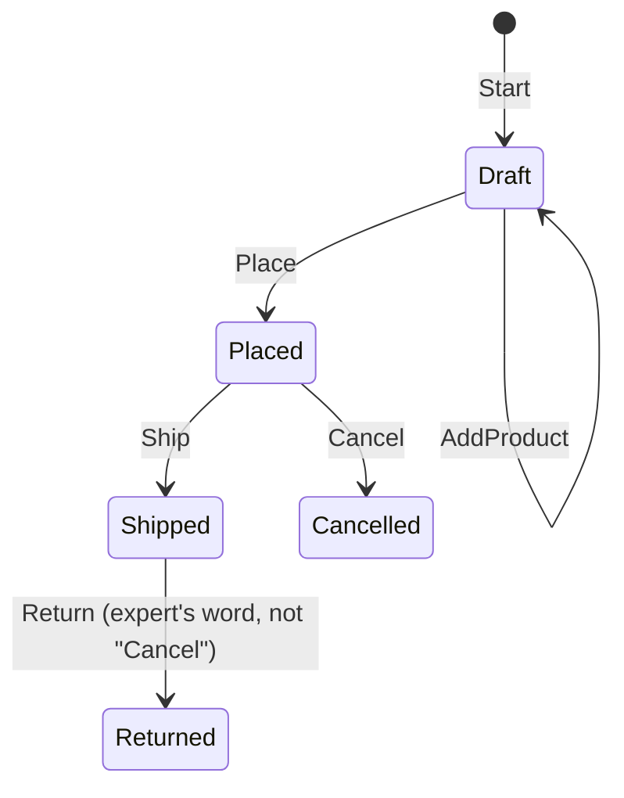

# 00 · Ubiquitous Language

**Definition:** one shared vocabulary used by domain experts AND in the code (class, method, and event names), inside one bounded context.

## 1. Example

Glossary agreed with the shop's operations team:

| Term | Meaning | In code |
|---|---|---|
| Order | a customer's request to buy products | `class Order` |
| Place | customer confirms; products can no longer change | `order.Place()` |
| Ship | warehouse hands a placed order to the courier | `order.Ship()` |
| Cancel | customer withdraws a **placed** order before it ships | `order.Cancel()` |
| Return | getting back a **shipped** order (not a cancel!) | future `order.Return()` |

```
Initial data:
  order                  : ORD-1, Draft, 0 products

Commands:
  AddProduct("Keyboard") : 1 product
  Place()                : Placed
  AddProduct("Mouse")    : rejected (only a draft order can change its products)
  Ship()                 : Shipped
  Cancel()               : rejected (shipped orders are returned, not cancelled)

Result:
  order                  : ORD-1, Shipped, 1 product
  developer version      : Process(row, 1) -> row.S = 1   (nobody knows what 1 or S means)
```

## 2. Diagram



## 3. Code

```csharp
public void Cancel()
{
    if (Status != OrderStatus.Placed)
        throw new InvalidOperationException($"a {Status} order cannot be cancelled (shipped orders are returned)");
    Status = OrderStatus.Cancelled;
}
```

Run: `dotnet run --project 00-ubiquitous-language`

```
✅ Ubiquitous language: code reads like the glossary
  Order.Start("ORD-1")            : Draft
  order.AddProduct("Keyboard")    : 1 product
  order.Place()                   : Placed
  order.AddProduct("Mouse")       : rejected -> only a draft order can change its products
  order.Ship()                    : Shipped
  order.Cancel()                  : rejected -> a Shipped order cannot be cancelled (shipped orders are returned)

❌ Developer language: same rules, nobody in the business can read them
  OrderProcessor.Process(row, 1)  : row.S = 1  (what is 1? what is S?)
```

## ✅ vs ❌

| ✅ Correct | ❌ Wrong | Why |
|---|---|---|
| `order.Place()` | `order.Status = 1` | the expert can read and verify the first |
| `OrderPlaced` event | `OrderUpdated` / `RecordChanged` | says **what** happened in business terms |
| glossary per context ("Product" in Sales ≠ Shipping) | one company-wide dictionary | words change meaning between contexts (see [10](../10-bounded-context/)) |
| rename code when the experts rename the concept | keep old names "for compatibility" | the language and the code drift apart |

**Next →** [01 Anemic vs Rich Model](../01-anemic-vs-rich-model/)
