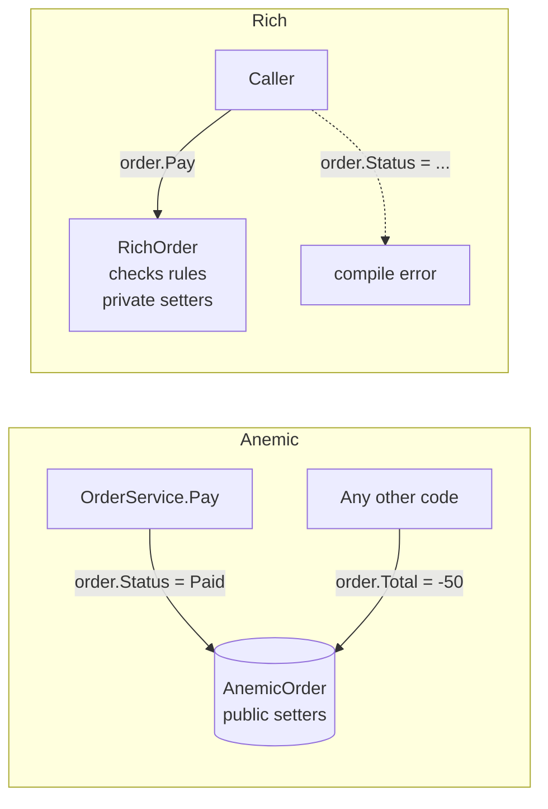

# 01 · Anemic vs Rich Model

**Definition:**
- **Anemic model:** objects that only hold data (public getters/setters); the rules live in "service" classes.
- **Rich model:** objects hold data **and** the behavior that protects their rules (invariants).

## 1. Example

```
Initial data:
  anemic order         : 0 lines, Status "Draft"
  rich order           : 0 lines, Status Draft

Commands (anemic):
  Total = -50          : accepted  -> Total = -50
  service.Pay(order)   : accepted  -> Status = "Paid" with 0 lines
  Status = "Shipped-ish": accepted

Commands (rich):
  Pay()                : rejected (an empty order cannot be paid)
  AddLine(-50)         : rejected (price must be positive)
  AddLine(30), AddLine(20): Total = 50 (calculated, never set)
  Pay()                : Status = Paid
  AddLine(10)          : rejected (a paid order cannot change)

Result:
  anemic               : 3 invalid states reached
  rich                 : 0 invalid states possible
```

## 2. Diagram



## 3. Code

```csharp
// ❌ Anemic
sealed class AnemicOrder { public decimal Total { get; set; } public string Status { get; set; } = "Draft"; }
static class AnemicOrderService { public static void Pay(AnemicOrder o) => o.Status = "Paid"; }

// ✅ Rich
public void Pay()
{
    if (_linePrices.Count == 0)
        throw new InvalidOperationException("an empty order cannot be paid");
    Status = OrderStatus.Paid;
}
```

Run: `dotnet run --project 01-anemic-vs-rich-model`

```
❌ Anemic model: data bag + service, rules are optional
  anemic.Total = -50              : accepted, Total = -50
  service.Pay(order with 0 lines) : accepted, Status = Paid
  anemic.Status = "Shipped-ish"   : accepted, Status = Shipped-ish

✅ Rich model: the object protects its own rules
  rich.Pay() with 0 lines         : rejected -> an empty order cannot be paid
  rich.AddLine(-50)               : rejected -> price must be positive
  rich.AddLine(30), AddLine(20)   : Total = 50 (calculated, never set)
  rich.Pay()                      : Status = Paid
  rich.AddLine(10) after pay      : rejected -> a paid order cannot change
```

## ✅ vs ❌

| ✅ Correct | ❌ Wrong | Why |
|---|---|---|
| `private set` + methods | `public set` everywhere | anyone can break the invariant |
| `Total` calculated from lines | `Total` stored and set by callers | two sources of truth go out of sync |
| rule in the entity (`Pay()` checks lines) | rule copied in 3 services | someone forgets it in the 4th |
| anemic is OK for a simple CRUD (Generic/Supporting subdomain) | rich model for a settings table | DDD effort belongs in the Core domain (see [13](../13-subdomains/)) |

**Next →** [02 Value Object](../02-value-object/)
