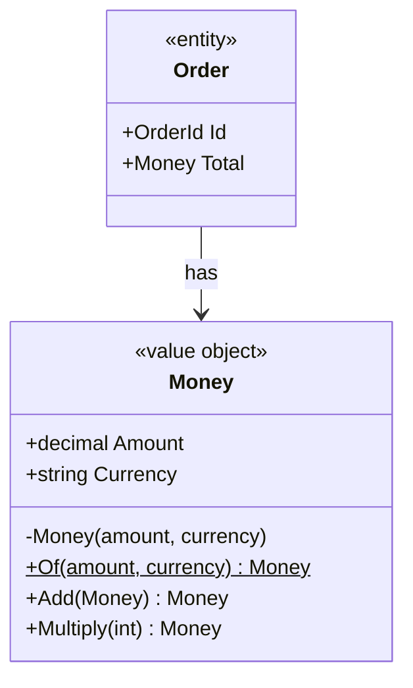

# 02 · Value Object

**Definition:** a small immutable object with **no identity**: two value objects with the same values are equal (e.g. `Money`, `Address`, `DateRange`). It validates itself on creation, so it is always valid.

## 1. Example

```
Initial data:
  a                     : Money.Of(10, USD) -> 10.00 USD
  b                     : Money.Of(10, USD) -> 10.00 USD

Commands:
  a == b                : True   (same values)
  ReferenceEquals(a, b) : False  (different objects, does not matter)
  a.Add(5.50 USD)       : 15.50 USD (a NEW object)
  a after Add           : 10.00 USD (unchanged: immutable)
  a.Multiply(3)         : 30.00 USD
  Money.Of(-5, USD)     : rejected (money cannot be negative)
  a.Add(10 EUR)         : rejected (cannot add EUR to USD)

Result:
  with Money            : invalid money cannot exist
  with decimal          : 10 USD + 10 EUR = 20 (20 what?), -5 accepted
```

## 2. Diagram



## 3. Code

```csharp
sealed record Money   // record = value equality for free
{
    private Money(decimal amount, string currency) { Amount = amount; Currency = currency; }
    public decimal Amount { get; }
    public string Currency { get; }

    public static Money Of(decimal amount, string currency)
    {
        if (amount < 0) throw new ArgumentException("money cannot be negative");
        if (!KnownCurrencies.Contains(currency)) throw new ArgumentException($"unknown currency '{currency}'");
        return new Money(decimal.Round(amount, 2), currency);
    }

    public Money Add(Money other)
    {
        if (other.Currency != Currency) throw new ArgumentException($"cannot add {other.Currency} to {Currency}");
        return Of(Amount + other.Amount, Currency);
    }
}
```

Run: `dotnet run --project 02-value-object`

```
✅ Value object: equal by value, immutable, always valid
  a = Money.Of(10, USD)       : 10.00 USD
  b = Money.Of(10, USD)       : 10.00 USD
  a == b                      : True
  ReferenceEquals(a, b)       : False
  a.Add(5.50 USD)             : 15.50 USD
  a after Add (unchanged)     : 10.00 USD
  a.Multiply(3)               : 30.00 USD
  Money.Of(-5, USD)           : rejected -> money cannot be negative
  Money.Of(5, XYZ)            : rejected -> unknown currency 'XYZ'
  a.Add(Money.Of(10, EUR))    : rejected -> cannot add EUR to USD

❌ Primitive obsession: decimal has no currency and no rules
  priceUsd + priceEur         : 20  (20 what?)
  decimal negative = -5       : accepted, -5
```

## ✅ vs ❌

| ✅ Correct | ❌ Wrong | Why |
|---|---|---|
| `Money Total` | `decimal Total` + `string Currency` | primitive obsession: rules are scattered and forgotten |
| `a.Add(b)` returns a new `Money` | `a.Amount += 5` | shared values change under other objects' feet |
| validate in `Of()` / constructor | validate in every service | invalid values sneak in through one path |
| `Email`, `Quantity`, `Address` as value objects | `string email` everywhere | `"abc"` is a valid string but not a valid email |

**Next →** [03 Entity](../03-entity/)
