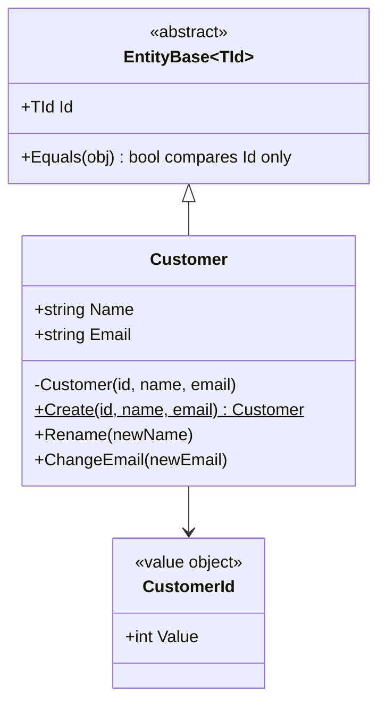

# 03 · Entity

**Definition:** an object defined by its **identity** (Id), not by its attributes. Its attributes may change over time; it stays the same entity (e.g. a `Customer` who changes name and email).

## 1. Example

```
Initial data:
  ali1                        : Id=1, Ali, ali@shop.com
  ali2                        : Id=2, Ali, ali@shop.com

Commands:
  ali1 == ali2                : False  (same data, different Id)
  ali1.Rename("Ali Hassan")   : Id=1, Ali Hassan
  ali1.ChangeEmail(...)       : Id=1, Ali Hassan, ali.hassan@shop.com
  loadedAgain (Id=1 from DB)  : ali1 == loadedAgain -> True
  HashSet{ali1, loadedAgain, ali2}: Count = 2
  Rename("")                  : rejected (name is required)

Result:
  equality rule               : Entity -> by Id ; Value object -> by values
```

## 2. Diagram



## 3. Code

```csharp
abstract class EntityBase<TId> where TId : notnull
{
    protected EntityBase(TId id) => Id = id;
    public TId Id { get; }
    public override bool Equals(object? obj) =>
        obj is EntityBase<TId> other && other.GetType() == GetType() && other.Id.Equals(Id);
    public override int GetHashCode() => Id.GetHashCode();
}

readonly record struct CustomerId(int Value);   // typed id: cannot be mixed with OrderId

sealed class Customer : EntityBase<CustomerId>
{
    private Customer(CustomerId id, string name, string email) : base(id) { ... }
    public static Customer Create(CustomerId id, string name, string email) { ... }
    public void Rename(string newName) { ... }
}
```

Run: `dotnet run --project 03-entity`

```
✅ Entity: equal by identity, attributes may change
  ali1                              : Id=1, Ali, ali@shop.com
  ali2                              : Id=2, Ali, ali@shop.com
  ali1 == ali2 (same data)          : False
  ali1 after rename + email         : Id=1, Ali Hassan, ali.hassan@shop.com
  ali1 == loadedAgain (Id 1)        : True
  HashSet {ali1, loadedAgain, ali2} : Count = 2
  Rename("")                        : rejected -> name is required

✅ Typed ids stop mixing identities
  CustomerId(1) == OrderId(1)?      : does not compile: different types
  orderId                           : OrderId { Value = 1 }
```

## ✅ vs ❌

| ✅ Correct | ❌ Wrong | Why |
|---|---|---|
| `Equals` compares `Id` | default reference equality | the same customer loaded twice looks like two customers |
| private constructor + `Create()` | `new Customer { Name = "" }` | creation rules are skipped |
| `Rename()`, `ChangeEmail()` | `customer.Name = x` | no place to validate or raise an event |
| `CustomerId` typed id | `int customerId` | `GetOrder(customerId)` compiles by mistake |
| make it a value object if identity does not matter | `Address` with an Id | needless identity = needless complexity |

**Next →** [04 Aggregate](../04-aggregate/)
