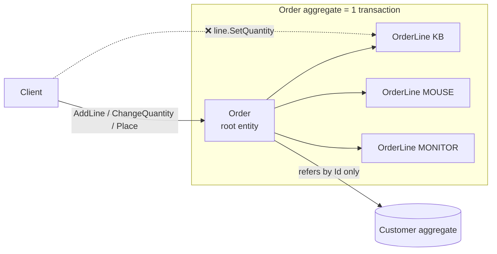

# 04 · Aggregate

**Definition:** a cluster of entities + value objects treated as **one unit for changes**. Outside code talks only to its **root**; the root enforces all invariants (rules that must always be true) inside the boundary.

## 1. Example

Invariants of `Order`: max 3 lines · total ≤ 5,000 · changes only while Draft · lines only via the root.

```
Initial data:
  order                        : ORD-1, Draft, 0 lines, total 0

Commands:
  AddLine(KB, 100, 2)          : 1 line,  total 200
  AddLine(MOUSE, 25, 4)        : 2 lines, total 300
  AddLine(KB, 100, 1)          : 2 lines, total 400   (same SKU -> merged, KB qty 3)
  AddLine(MONITOR, 1500, 1)    : 3 lines, total 1900
  AddLine(CABLE, 5, 1)         : rejected (max 3 lines per order)
  ChangeQuantity(MONITOR, 3)   : 3 lines, total 4900
  ChangeQuantity(MONITOR, 2)   : 3 lines, total 3400
  Place()                      : Placed
  AddLine(CABLE, 5, 1)         : rejected (a placed order cannot change)

Result:
  KB                           : 3 x 100  = 300
  MOUSE                        : 4 x 25   = 100
  MONITOR                      : 2 x 1500 = 3000
  Total                        : 3400 (<= 5000 always held)
```

## 2. Diagram



## 3. Code

```csharp
public void AddLine(string sku, decimal unitPrice, int quantity)
{
    EnsureDraft();
    EnsureTotalWithinLimit(Total + unitPrice * quantity);

    var existing = _lines.FirstOrDefault(l => l.Sku == sku);
    if (existing is not null) { existing.SetQuantity(existing.Quantity + quantity); return; }

    if (_lines.Count == MaxLines)
        throw new DomainException($"max {MaxLines} lines per order");
    _lines.Add(new OrderLine(sku, unitPrice, quantity));   // OrderLine ctor is internal
}

public IReadOnlyList<OrderLine> Lines => _lines.AsReadOnly();  // callers cannot Add/Remove
```

Run: `dotnet run --project 04-aggregate`

```
  AddLine(KB, 100, qty 2)             : ok -> 1 lines, total 200
  AddLine(MOUSE, 25, qty 4)           : ok -> 2 lines, total 300
  AddLine(KB, 100, qty 1) same SKU    : ok -> 2 lines, total 400
  AddLine(MONITOR, 1500, qty 1)       : ok -> 3 lines, total 1900
  AddLine(CABLE, 5, qty 1) 4th line   : rejected -> max 3 lines per order
  ChangeQuantity(MONITOR, 3)          : ok -> 3 lines, total 4900
  ChangeQuantity(MONITOR, 2)          : ok -> 3 lines, total 3400
  Place()                             : Placed
  AddLine(CABLE, 5, qty 1) placed     : rejected -> a placed order cannot change

  line KB                             : 3 x 100 = 300
  line MOUSE                          : 4 x 25 = 100
  line MONITOR                        : 2 x 1500 = 3000
  Total                               : 3400
```

## ✅ vs ❌

| ✅ Correct | ❌ Wrong | Why |
|---|---|---|
| change lines via `order.AddLine()` | `order.Lines.Add(...)` | the root cannot check max lines / total |
| reference other aggregates **by Id** (`CustomerId`) | `Order.Customer.Orders...` object graph | huge loads, unclear transaction boundary |
| **one aggregate per transaction** | update Order + Stock + Customer in one transaction | locks and conflicts; use events instead ([08](../08-domain-events/)) |
| small aggregates (root + few children) | `Customer` containing all orders forever | loading 10,000 orders to add one |
| one repository per aggregate root | `OrderLineRepository` | lines must not be saved without their root |

**Next →** [05 Repository](../05-repository/)
