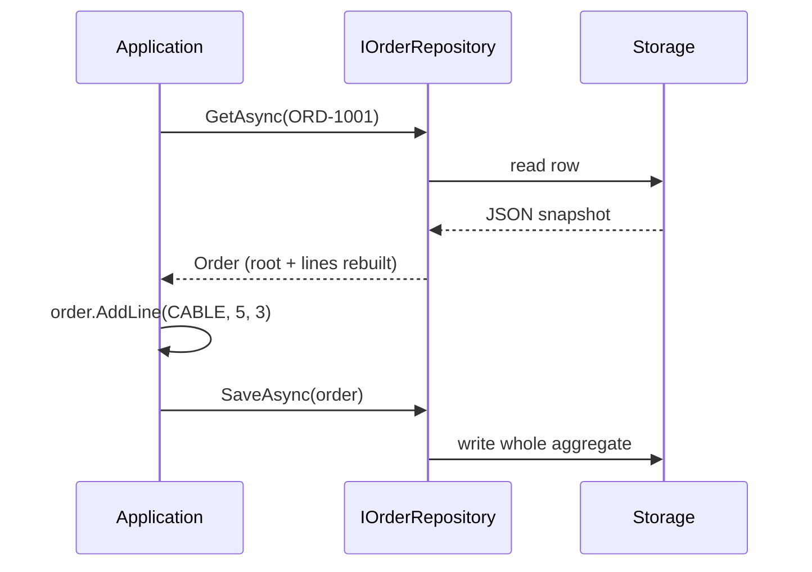

# 05 · Repository

**Definition:** a collection-like interface to **load and save whole aggregates**. The domain defines the interface (`IOrderRepository`); infrastructure implements it (EF Core, Mongo, in-memory). The domain never sees SQL or tables.

## 1. Example

```
Initial data:
  ORD-1001                     : KB 2 x 100, MOUSE 1 x 25 (total 225)

Commands:
  SaveAsync(ORD-1001)          : stored 2 lines
  copy = GetAsync(ORD-1001)    : fresh object
  copy.AddLine(CABLE, 5, 3)    : copy has 3 lines in memory
  GetAsync(ORD-1001)           : stored still 2 lines (not saved)
  SaveAsync(copy)              : stored 3 lines, total 240
  GetAsync(ORD-404)            : null

Result:
  stored row                   : {"Id":"ORD-1001","Lines":[KB, MOUSE, CABLE]}  (one aggregate = one unit)
```

## 2. Diagram



## 3. Code

```csharp
// Domain layer owns this interface
interface IOrderRepository
{
    Task<Order?> GetAsync(OrderId id, CancellationToken ct);
    Task SaveAsync(Order order, CancellationToken ct);
}

// Infrastructure implements it
sealed class InMemoryOrderRepository : IOrderRepository
{
    private readonly Dictionary<OrderId, string> _rows = [];
    public Task SaveAsync(Order order, CancellationToken ct)
    {
        _rows[order.Id] = JsonSerializer.Serialize(order.ToSnapshot());
        return Task.CompletedTask;
    }
    ...
}
```

Run: `dotnet run --project 05-repository`

```
  SaveAsync(ORD-1001)               : 2 lines, total 225
  GetAsync + AddLine(CABLE) no save : in memory: 3 lines
  GetAsync again                    : stored: 2 lines (change not saved)
  SaveAsync(copy) + GetAsync        : stored: 3 lines, total 240
  GetAsync(ORD-404)                 : null

  Stored row (whole aggregate in one document):
  {"Id":"ORD-1001","Lines":[{"Sku":"KB","UnitPrice":100,"Quantity":2},{"Sku":"MOUSE","UnitPrice":25,"Quantity":1},{"Sku":"CABLE","UnitPrice":5,"Quantity":3}]}
```

## ✅ vs ❌

| ✅ Correct | ❌ Wrong | Why |
|---|---|---|
| one repository per **aggregate root** | `OrderLineRepository` | lines could change without root checks |
| `GetAsync(id)`, `SaveAsync(order)`, domain-named finders | `IQueryable<Order> Query()` exposed to the domain | persistence leaks into the domain |
| interface in the domain, implementation in infrastructure | domain references `DbContext` | domain cannot be tested without a DB |
| for screens/reports, a separate read model ([16 CQRS](../16-cqrs/)) | 15 `GetByXAndY` methods on the repository | the repository becomes a query dump |

**Next →** [06 Domain Service](../06-domain-service/)
