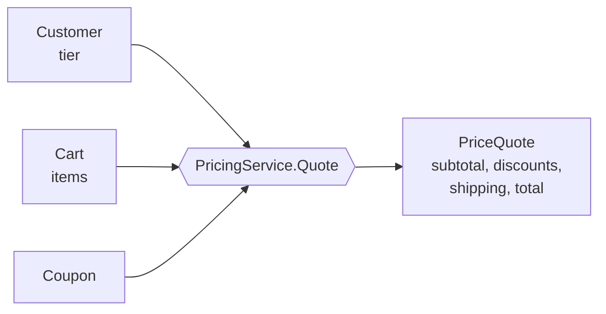

# 06 · Domain Service

**Definition:** a **stateless** operation that holds domain logic which belongs to no single entity or value object, because it needs several of them. Named with a verb or a role from the ubiquitous language (e.g. `PricingService.Quote`).

## 1. Example

Rules: VIP gets 10% off · coupon WELCOME50 = −50 · shipping 20, free when the amount after discounts is ≥ 500.

```
Initial data:
  Sara                 : Regular, cart 3 x KB 100 = 300
  Omar                 : VIP,     cart 1 x MONITOR 600 = 600
  Omar + coupon        : VIP,     cart KB 100 + 18 x MOUSE 25 = 550, WELCOME50

Commands:
  Quote(Sara)          : 300 - 0 - 0 + 20         = 320.00
  Quote(Omar)          : 600 - 60 - 0 + 0         = 540.00  (540 >= 500 -> free shipping)
  Quote(Omar, coupon)  : 550 - 55 - 50 + 20       = 465.00  (445 < 500 -> shipping 20)

Result:
  one place            : all pricing rules live in PricingService
```

## 2. Diagram



## 3. Code

```csharp
sealed class PricingService
{
    public PriceQuote Quote(Customer customer, Cart cart, Coupon? coupon)
    {
        var subtotal = cart.Subtotal;
        var vipDiscount = customer.Tier == CustomerTier.Vip ? decimal.Round(subtotal * VipRate, 2) : 0;
        var couponDiscount = coupon?.Amount ?? 0;
        var afterDiscounts = subtotal - vipDiscount - couponDiscount;
        var shipping = afterDiscounts >= FreeShippingFrom ? 0 : ShippingFee;
        return new PriceQuote(subtotal, vipDiscount, couponDiscount, shipping);
    }
}
```

Run: `dotnet run --project 06-domain-service`

```
Sara (Regular), cart 300
  subtotal      : 300.00
  vip discount  : -0.00
  coupon        : -0.00
  shipping      : 20.00
  total         : 320.00

Omar (VIP), cart 600
  subtotal      : 600.00
  vip discount  : -60.00
  coupon        : -0.00
  shipping      : 0.00
  total         : 540.00

Omar (VIP), cart 550 + WELCOME50
  subtotal      : 550.00
  vip discount  : -55.00
  coupon        : -50.00
  shipping      : 20.00
  total         : 465.00

```

## ✅ vs ❌

| ✅ Correct | ❌ Wrong | Why |
|---|---|---|
| logic that needs **several** objects → domain service | `customer.PriceCart(cart, coupon)` | Customer now knows carts and coupons |
| logic that needs **one** object → method on that entity | `OrderService.Pay(order)` | back to the anemic model ([01](../01-anemic-vs-rich-model/)) |
| stateless, pure domain types in/out | domain service calls the DB / sends email | that is an **application** service's job |
| named in the domain language (`Quote`, `TransferFunds`) | `OrderManager`, `Helper`, `Utils` | names that say nothing |

**Next →** [07 Factory](../07-factory/)
