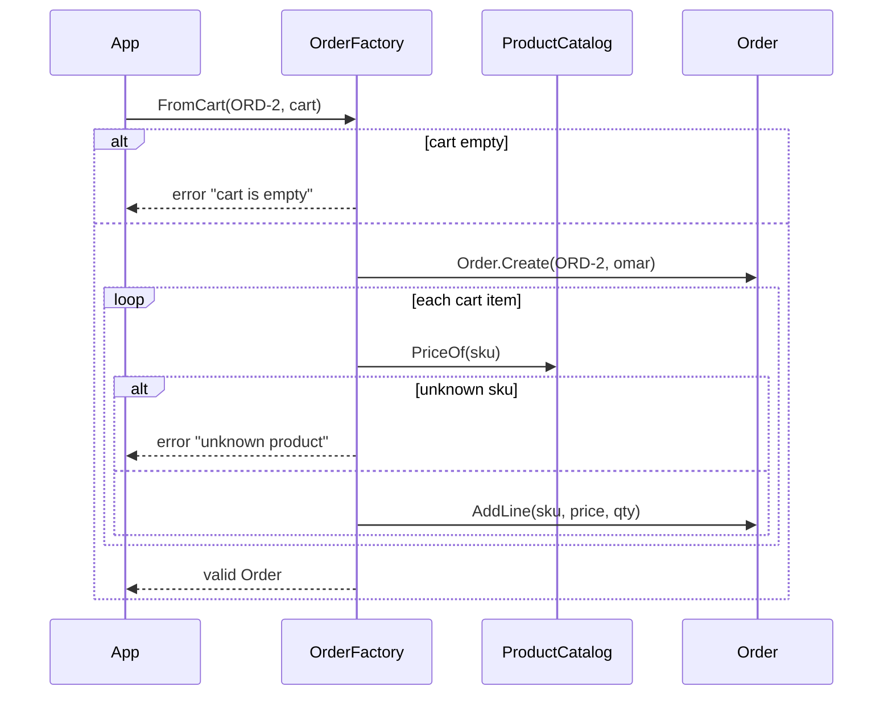

# 07 · Factory

**Definition:** an object or method whose only job is to **create a valid aggregate** when creation is complex (needs other objects, lookups, or many rules). Simple creation stays as a static `Create()` on the aggregate.

## 1. Example

```
Initial data:
  catalog                     : KB = 100, MOUSE = 25
  cart (omar)                 : KB x 2, MOUSE x 1

Commands:
  Order.Create(ORD-1, sara)   : empty draft order (simple creation)
  factory.FromCart(ORD-2,cart): KB 2 x 100, MOUSE 1 x 25 -> total 225
  catalog: KB -> 120          : ORD-2 total still 225 (price copied at creation)
  FromCart(empty cart)        : rejected (cart is empty)
  FromCart(TV x 1)            : rejected (unknown product 'TV')

Result:
  every order created         : valid, with prices fixed at order time
```

## 2. Diagram



## 3. Code

```csharp
sealed class OrderFactory(ProductCatalog catalog)
{
    public Order FromCart(string orderId, Cart cart)
    {
        if (cart.Items.Count == 0)
            throw new InvalidOperationException("cart is empty");

        var order = Order.Create(orderId, cart.CustomerId);
        foreach (var item in cart.Items)
        {
            var price = catalog.PriceOf(item.Sku)
                ?? throw new InvalidOperationException($"unknown product '{item.Sku}'");
            order.AddLine(item.Sku, price, item.Quantity);
        }
        return order;
    }
}
```

Run: `dotnet run --project 07-factory`

```
✅ Simple creation: static Create() on the aggregate
  Order.Create(ORD-1, sara)   : 0 lines

✅ Complex creation: factory builds a valid order from a cart
  line KB                     : 2 x 100
  line MOUSE                  : 1 x 25
  total                       : 225
  catalog: KB price -> 120    : order total still 225 (price snapshot)
  FromCart(empty cart)        : rejected -> cart is empty
  FromCart(unknown SKU 'TV')  : rejected -> unknown product 'TV'
```

## ✅ vs ❌

| ✅ Correct | ❌ Wrong | Why |
|---|---|---|
| simple: `Order.Create(id, customerId)` | factory class for a 2-field object | needless ceremony |
| complex: `OrderFactory.FromCart(...)` | 30 lines of creation code in a controller | rules copied in each caller |
| copy the price into the order line | keep a reference to the catalog price | yesterday's order changes when the price changes |
| factory returns a **valid** object or throws | returns a half-built object, caller "finishes" it | invalid aggregates exist for a moment, then forever |

**Next →** [08 Domain Events](../08-domain-events/)
