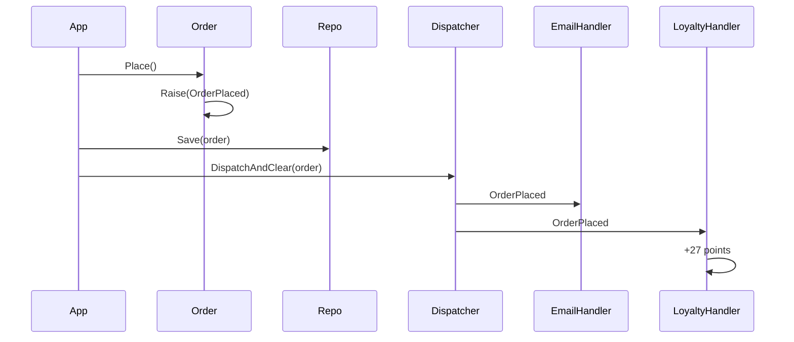

# 08 · Domain Events

**Definition:** a record of **something that happened** in the domain that the experts care about, named in the past tense (`OrderPlaced`). The aggregate raises it; handlers react **after** the aggregate is saved, so side effects stay out of the aggregate.

## 1. Example

```
Initial data:
  order                    : ORD-1, sara@shop.com, 2 x 100 + 3 x 25 = 275 USD
  loyalty[sara]            : 0

Commands:
  order.Place()            : 1 pending event: OrderPlaced
  repository.Save(order)   : saved
  dispatch                 : EmailHandler   -> 'Order ORD-1 confirmed, 275 USD'
                             LoyaltyHandler -> +27 points (275 / 10)
  order.Cancel(...)        : OrderCancelled -> StockHandler releases stock

Result:
  pending events           : 0 (cleared after dispatch)
  loyalty[sara]            : 27
  Order class knows        : nothing about email, loyalty, or stock
```

## 2. Diagram



## 3. Code

```csharp
sealed record OrderPlaced(string OrderId, string CustomerEmail, decimal Total, DateTime OccurredAt) : IDomainEvent;

abstract class AggregateRoot
{
    private readonly List<IDomainEvent> _domainEvents = [];
    public IReadOnlyList<IDomainEvent> DomainEvents => _domainEvents.AsReadOnly();
    protected void Raise(IDomainEvent e) => _domainEvents.Add(e);
    public void ClearDomainEvents() => _domainEvents.Clear();
}

public void Place(DateTime now)
{
    _placed = true;
    Raise(new OrderPlaced(Id, CustomerEmail, Total, now));
}
```

Run: `dotnet run --project 08-domain-events`

```
  order.Place()   : 1 pending event: OrderPlaced
  repository.Save(order)  -> then dispatch:
  [EmailHandler]   send 'Order ORD-1 confirmed, 275 USD' to sara@shop.com
  [LoyaltyHandler] +27 points for sara@shop.com (1 point per 10 USD)
  after dispatch  : 0 pending events
  [StockHandler]   release stock of order ORD-1, reason 'customer changed mind'
  loyalty[sara]   : 27
```

## ✅ vs ❌

| ✅ Correct | ❌ Wrong | Why |
|---|---|---|
| `OrderPlaced` (past tense, business fact) | `PlaceOrder` / `SendEmail` event | that is a command, not something that happened |
| aggregate **raises**, handlers **react** | `order.Place()` calls `emailService.Send()` | aggregate depends on infrastructure |
| dispatch **after** save | dispatch before save | email sent for an order that then failed to save |
| other aggregates updated in **their own** transaction via handlers | one transaction for Order + Loyalty | breaks "one aggregate per transaction" ([04](../04-aggregate/)) |
| cross-service? map to an integration event ([14](../14-integration-events/)) | publish the domain event class to Kafka | internal model becomes a public contract |

**Next →** [09 Specification](../09-specification/)
