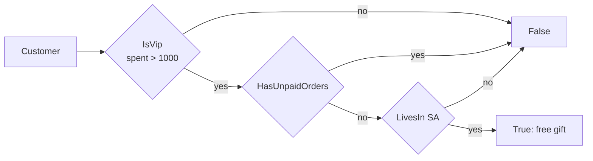

# 09 · Specification

**Definition:** a business rule packaged as an object with one question, `IsSatisfiedBy(candidate)`. Specifications have domain names and combine with `And`, `Or`, `Not`, so complex rules read like the business sentence.

## 1. Example

Rule: *"a free gift goes to **VIP** customers (spent > 1000) in **Saudi Arabia** with **no unpaid orders**."*

```
Initial data:
  Sara                 : spent 1500, unpaid 0, SA
  Omar                 : spent 2200, unpaid 1, SA
  Lina                 : spent 800,  unpaid 0, SA
  John                 : spent 3000, unpaid 0, UK

Commands:
  freeGift = IsVip AND NOT HasUnpaid AND LivesIn(SA)
  Sara                 : VIP ✔, no unpaid ✔, SA ✔ -> True
  Omar                 : VIP ✔, unpaid 1 ✘        -> False
  Lina                 : VIP ✘ (800 <= 1000)      -> False
  John                 : VIP ✔, UK ✘              -> False

Result:
  free gift winners    : Sara
```

## 2. Diagram



## 3. Code

```csharp
abstract class Specification<T>
{
    public abstract bool IsSatisfiedBy(T candidate);
    public Specification<T> And(Specification<T> other) => new AndSpecification<T>(this, other);
    public Specification<T> Or(Specification<T> other) => new OrSpecification<T>(this, other);
    public Specification<T> Not() => new NotSpecification<T>(this);
}

sealed class IsVipCustomer : Specification<Customer>
{
    public const decimal Threshold = 1000;
    public override bool IsSatisfiedBy(Customer c) => c.TotalSpent > Threshold;
}

var freeGift = isVip.And(hasUnpaid.Not()).And(livesInSaudi);
```

Run: `dotnet run --project 09-specification`

```
  customer | spent | unpaid | country |  VIP? | free gift?
  Sara     |  1500 |      0 |      SA |  True |       True
  Omar     |  2200 |      1 |      SA |  True |      False
  Lina     |   800 |      0 |      SA | False |      False
  John     |  3000 |      0 |      UK |  True |      False

  free gift winners: Sara
```

## ✅ vs ❌

| ✅ Correct | ❌ Wrong | Why |
|---|---|---|
| `IsVipCustomer` defined once | `c.TotalSpent > 1000` copied in 6 places | change the threshold → miss one place |
| combine: `isVip.And(hasUnpaid.Not())` | one giant `if` with 8 conditions | unreadable, untestable parts |
| use for **validation, selection, creation** rules | spec for a trivial one-off check | needless ceremony |
| with EF Core: `Expression<Func<T,bool>>` specs so SQL can run them | load all customers then filter in memory | slow on 1M rows |

**Next →** [10 Bounded Context](../10-bounded-context/)
