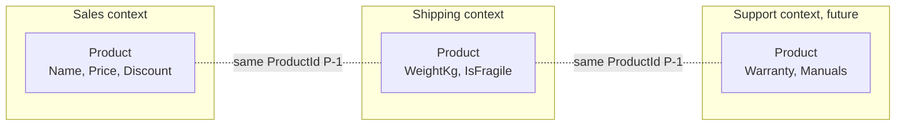

# 10 · Bounded Context

**Definition:** an explicit boundary (code, team, often a service or a database) inside which **one model and one ubiquitous language** apply. The same word can mean different things in different contexts, and that is fine.

## 1. Example

Same product `P-1`, two models:

```
Initial data:
  Sales    P-1         : "Monitor 27"", price 1500 USD, discount 10%
  Shipping P-1         : 6.5 kg, fragile

Commands:
  Sales.FinalPrice     : 1500 x (1 - 10/100)       = 1350 USD
  Shipping.Cost        : 5 + 6.5 x 2 + 10 (fragile) = 28 USD

Result:
  shared               : only the id "P-1"
  Sales knows          : nothing about weight
  Shipping knows       : nothing about price
```

## 2. Diagram



## 3. Code

Folder per context, each with its own `Product`:

```
10-bounded-context/
  Sales/Product.cs       record Product(ProductId, Name, PriceUsd, DiscountPercent)
  Shipping/Product.cs    record Product(ProductId, WeightKg, IsFragile)
```

```csharp
namespace BoundedContext.Shipping;

public sealed record Product(string ProductId, decimal WeightKg, bool IsFragile)
{
    public decimal ShippingCost => BaseFee + WeightKg * PerKg + (IsFragile ? FragileFee : 0);
}
```

Run: `dotnet run --project 10-bounded-context`

```
Sales context: Product = something we sell
  name                  : Monitor 27"
  price                 : 1500 USD
  discount              : 10%
  final price           : 1350.0 USD

Shipping context: Product = a box to deliver
  weight                : 6.5 kg
  fragile               : True
  shipping cost         : 5 + 6.5 x 2 + 10 = 28.0 USD

Shared between contexts: only the id
  forSales.ProductId    : P-1
  forShipping.ProductId : P-1
```

## ✅ vs ❌

| ✅ Correct | ❌ Wrong | Why |
|---|---|---|
| one `Product` per context, small and focused | one `Product` class with 40 fields for everyone | every change risks breaking 5 teams |
| contexts share **ids**, not classes | `Shipping` references `Sales.Product` | hidden coupling, cannot deploy separately |
| boundary often = team + repo/module + own DB schema | two services writing the same table | that is still one context, badly split |
| find contexts by **language changes** ("Product" means something else here) | split by technical layer (UI / DB / API) | layers are not business boundaries |

**Next →** [11 Context Map](../11-context-map/)
