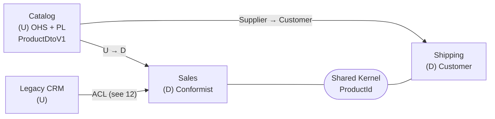

# 11 · Context Map

**Definition:** a diagram + agreement that shows **how bounded contexts relate**: who is upstream (U, provides) and downstream (D, consumes), and which integration pattern each relationship uses.

| Pattern | One-line meaning |
|---|---|
| **Shared Kernel** | two contexts share a small model and change it only together |
| **Customer / Supplier** | downstream asks, upstream plans the change for them |
| **Conformist** | downstream uses upstream's model as-is (no power to ask) |
| **Anti-Corruption Layer** | downstream translates upstream's model into its own ([12](../12-anti-corruption-layer/)) |
| **Open Host Service** | upstream offers one public API for everyone |
| **Published Language** | a documented, versioned contract (JSON schema, Protobuf, DTO v1) |
| **Separate Ways** | no integration; each solves it alone |
| **Partnership** | two teams succeed or fail together, plan jointly |

## 1. Example

```
Initial data:
  Catalog (U)            : P-1 Monitor, 1500 USD, 6.5 kg (ProductDtoV1)
  Sales (D)              : Conformist, uses ProductDtoV1 as-is
  Shipping (D)           : Customer/Supplier, asked Catalog to add WeightKg
  Sales + Shipping       : Shared Kernel = ProductId

Commands:
  sales.Quote(P-1, 2)    : 2 x 1500 = 3000 USD
  shipping.Pack(P-1, 2)  : 2 x 6.5  = 13.0 kg parcel

Result:
  Catalog API            : one Open Host Service for both consumers
```

## 2. Diagram



## 3. Code

```
11-context-map/
  SharedKernel/ProductId.cs     owned by Sales + Shipping together
  Catalog/ProductDto.cs         Published Language: ProductDtoV1
  Catalog/CatalogApi.cs         Open Host Service
  Sales/QuoteService.cs         Conformist (uses ProductDtoV1 directly)
  Shipping/ParcelService.cs     Customer/Supplier, keeps its own Parcel model
```

```csharp
// Conformist: Sales uses the upstream ProductDtoV1 AS-IS
public decimal Quote(ProductId productId, int quantity)
{
    ProductDtoV1 product = catalog.GetProduct(productId.Value);
    return product.PriceUsd * quantity;
}
```

Run: `dotnet run --project 11-context-map`

```
Context map
  Catalog  -> Sales     : Upstream/Downstream, Open Host Service + Published Language, Sales = Conformist
  Catalog  -> Shipping  : Customer/Supplier (Shipping asked for WeightKg)
  Sales <-> Shipping    : Shared Kernel (ProductId)

Calls across the map
  sales.Quote(P-1, 2)   : 3000 USD
  shipping.Pack(P-1, 2) : Parcel P-1, 13.0 kg
```

## ✅ vs ❌

| ✅ Correct | ❌ Wrong | Why |
|---|---|---|
| draw the map **as it is today** (including the mess) | draw the ideal map only | decisions need the real coupling |
| version the published language (`ProductDtoV1`) | change DTO fields in place | breaks every downstream at once |
| Shared Kernel kept **tiny** (ids, Money) | shared "Common.Domain" project with 200 classes | all teams locked together |
| Conformist only when upstream's model is good enough | conform to a messy legacy model | the mess spreads into your core; use an ACL |

**Next →** [12 Anti-Corruption Layer](../12-anti-corruption-layer/)
