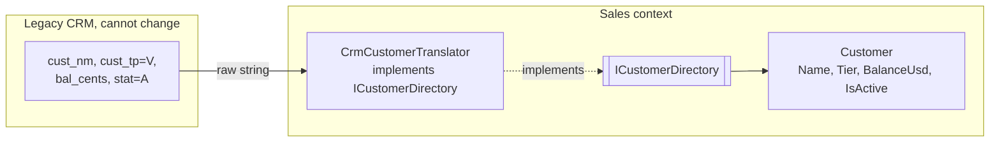

# 12 · Anti-Corruption Layer (ACL)

**Definition:** a translation layer at the border of your bounded context that converts an external (often legacy) model into **your** model, so foreign names, codes, and formats never leak into your domain.

## 1. Example

```
Initial data:
  CRM 501              : "cust_nm=ALI HASSAN;cust_tp=V;bal_cents=125050;stat=A"
  CRM 502              : "cust_nm=LINA SAAD;cust_tp=R;bal_cents=990;stat=I"
  CRM 503              : "cust_nm=JOHN DOE;cust_tp=Q;bal_cents=0;stat=A"

Commands:
  translate 501        : Name=Ali Hassan, Tier=Vip,     Balance=1250.5 USD, Active=True
  translate 502        : Name=Lina Saad,  Tier=Regular, Balance=9.9 USD,    Active=False
  translate 503        : rejected at the border (unknown CRM tier code 'Q')

Result:
  Sales domain sees    : Customer(Name, Tier, BalanceUsd, IsActive) only
  CRM knowledge        : 1 class (CrmCustomerTranslator)
```

## 2. Diagram



## 3. Code

```csharp
public sealed class CrmCustomerTranslator(CrmClient crm) : ICustomerDirectory
{
    public Customer Find(int customerId)
    {
        var fields = crm.FetchCustomerRecord(customerId).Split(';')
            .Select(pair => pair.Split('=')).ToDictionary(kv => kv[0], kv => kv[1]);

        return new Customer(
            Id: customerId,
            Name: TextInfo.ToTitleCase(fields["cust_nm"].ToLowerInvariant()),
            Tier: TranslateTier(fields["cust_tp"]),          // "V" -> Vip, "R" -> Regular
            BalanceUsd: int.Parse(fields["bal_cents"]) / 100m,
            IsActive: fields["stat"] == "A");
    }
}
```

Run: `dotnet run --project 12-anti-corruption-layer`

```
Customer 501
  legacy record : cust_nm=ALI HASSAN;cust_tp=V;bal_cents=125050;stat=A
  our model     : Name=Ali Hassan, Tier=Vip, Balance=1250.5 USD, Active=True

Customer 502
  legacy record : cust_nm=LINA SAAD;cust_tp=R;bal_cents=990;stat=I
  our model     : Name=Lina Saad, Tier=Regular, Balance=9.9 USD, Active=False

Customer 503
  legacy record : cust_nm=JOHN DOE;cust_tp=Q;bal_cents=0;stat=A
  our model     : rejected at the border -> unknown CRM tier code 'Q'

```

## ✅ vs ❌

| ✅ Correct | ❌ Wrong | Why |
|---|---|---|
| `if (customer.Tier == CustomerTier.Vip)` | `if (crmRecord.cust_tp == "V")` in domain code | legacy codes spread everywhere |
| port (`ICustomerDirectory`) owned by **your** context | domain calls `CrmClient` directly | cannot replace the CRM later |
| reject unknown codes **at the border** | default unknown to `Regular` silently | wrong discounts, no one notices |
| ACL when upstream's model is poor or foreign | ACL around a clean, well-versioned API you agree with | extra mapping for nothing (Conformist is fine) |

**Next →** [13 Subdomains](../13-subdomains/)
