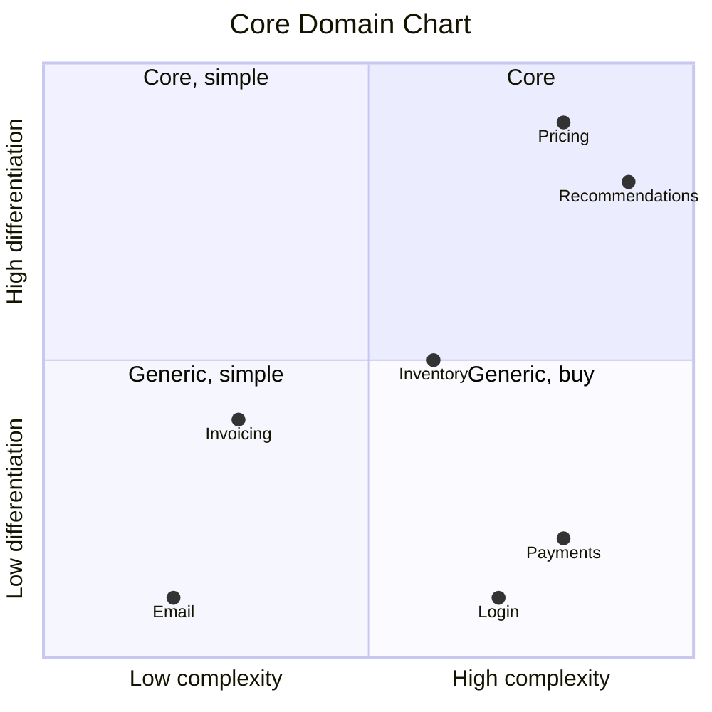

# 13 · Subdomains (Core, Supporting, Generic)

**Definition:** the business split into areas, classified by how much they set the company apart:
- **Core:** the reason customers choose you; complex and unique → build in-house with full DDD.
- **Supporting:** needed and specific to you, but not a differentiator → keep simple.
- **Generic:** solved the same way everywhere → buy or use a library/SaaS.

## 1. Example

Rule used: differentiation ≥ 7 → Core · ≤ 3 → Generic · otherwise Supporting.

```
Initial data (differentiation, complexity):
  Pricing & Promotions : 9, 8
  Recommendations      : 8, 9
  Inventory            : 5, 6
  Invoicing            : 4, 3
  Payments             : 2, 8
  Identity / Login     : 1, 7
  Email sending        : 1, 2

Commands:
  classify             : Core 2, Supporting 2, Generic 3

Result:
  Core                 : Pricing & Promotions, Recommendations -> best people, full DDD
  Supporting           : Inventory, Invoicing                  -> simple CRUD is fine
  Generic              : Payments (Stripe), Login (Keycloak/Entra ID), Email (SendGrid) -> buy
```

## 2. Diagram



## 3. Code

```csharp
sealed record Subdomain(string Name, int Differentiation, int Complexity)
{
    public SubdomainType Type => Differentiation switch
    {
        >= 7 => SubdomainType.Core,
        <= 3 => SubdomainType.Generic,
        _ => SubdomainType.Supporting,
    };
}
```

Run: `dotnet run --project 13-subdomains`

```
  subdomain              | diff | cplx | type       | strategy
  Pricing & Promotions   |    9 |    8 | Core       | build in-house, best people, full DDD
  Recommendations        |    8 |    9 | Core       | build in-house, best people, full DDD
  Inventory              |    5 |    6 | Supporting | build simple (CRUD is fine) or outsource
  Invoicing              |    4 |    3 | Supporting | build simple (CRUD is fine) or outsource
  Payments               |    2 |    8 | Generic    | buy / use SaaS or a library
  Identity / Login       |    1 |    7 | Generic    | buy / use SaaS or a library
  Email sending          |    1 |    2 | Generic    | buy / use SaaS or a library

  Core      : 2 -> Pricing & Promotions, Recommendations
  Supporting: 2 -> Inventory, Invoicing
  Generic   : 3 -> Payments, Identity / Login, Email sending
```

## ✅ vs ❌

| ✅ Correct | ❌ Wrong | Why |
|---|---|---|
| rich model + aggregates in **Core** | full DDD tactical patterns in Email sending | effort with no business return |
| buy Generic (Stripe, Keycloak) | build your own payment gateway | complex, risky, not your edge |
| juniors / outsourcing on Supporting | best seniors on the admin CRUD | waste of your strongest people |
| re-check classification yearly | label it once forever | yesterday's core becomes today's commodity |

**Next →** [14 Integration Events](../14-integration-events/)
