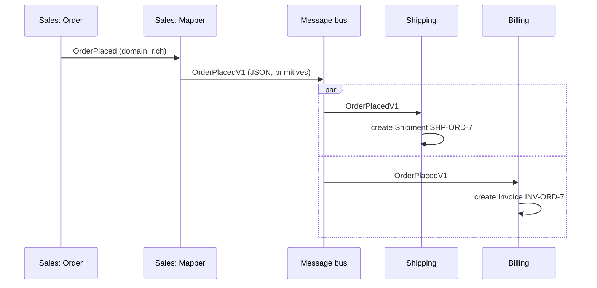

# 14 · Integration Events

**Definition:** a message that tells **other bounded contexts** that something happened. Unlike a domain event (internal, rich types), it is a **public contract**: primitives only, versioned (`V1`), serialized, and stable.

| | Domain event | Integration event |
|---|---|---|
| audience | same context | other contexts / services |
| types | rich (`OrderLine`, `Money`) | primitives (`string`, `decimal`) |
| change freely? | yes | no, version it (`V1`, `V2`) |
| transport | in-memory dispatcher | broker (Kafka, RabbitMQ, Service Bus) |

## 1. Example

```
Initial data:
  Sales order          : ORD-7, CUST-3, KB 2 x 100 + MOUSE 1 x 25

Commands:
  order.Place()        : domain event OrderPlaced (2 rich OrderLine objects)
  mapper               : OrderPlacedV1 {OrderId, CustomerId, TotalAmount=225, Currency, Skus[2], OccurredAtUtc}
  bus.Publish          : JSON on topic sales.order-placed.v1
  Shipping handler     : SHP-ORD-7 (Pending, 2 items)
  Billing handler      : INV-ORD-7 (225 USD for CUST-3)

Result:
  Shipping / Billing   : never reference Sales classes; each reads only the fields it needs
```

## 2. Diagram



## 3. Code

```csharp
// Public contract
sealed record OrderPlacedV1(string OrderId, string CustomerId, decimal TotalAmount,
                            string Currency, string[] Skus, DateTime OccurredAtUtc);

// Sales maps internal -> public
static OrderPlacedV1 ToIntegrationEvent(OrderPlaced e) =>
    new(e.OrderId, e.CustomerId, e.Total, "USD", e.Lines.Select(l => l.Sku).ToArray(), e.OccurredAt);

// Shipping keeps its own copy of only the fields it needs
sealed record OrderPlacedMessage(string OrderId, string[] Skus);
```

Run: `dotnet run --project 14-integration-events`

```
  Sales domain event  : OrderPlaced with 2 rich OrderLine objects
  [bus] sales.order-placed.v1: {"OrderId":"ORD-7","CustomerId":"CUST-3","TotalAmount":225,"Currency":"USD","Skus":["KB","MOUSE"],"OccurredAtUtc":"2026-10-25T10:00:00Z"}
  [Shipping] created SHP-ORD-7 for ORD-7
  [Billing]  created INV-ORD-7, 225 USD

  Shipping state      : SHP-ORD-7 (Pending, 2 items)
  Billing state       : INV-ORD-7 (225 USD for CUST-3)
```

## ✅ vs ❌

| ✅ Correct | ❌ Wrong | Why |
|---|---|---|
| map domain event → `OrderPlacedV1` | publish the domain event class | refactoring Sales breaks Shipping |
| primitives + ISO dates + currency code | `Money` / `OrderLine` objects | consumers need your assembly |
| add fields only; breaking change → `V2` topic | rename a field in place | every consumer fails at once |
| consumers own their message DTO | shared "Contracts" NuGet used by everyone for everything | hidden coupling returns |
| publish via an outbox ([15](../15-outbox-pattern/)) | `SaveChanges(); bus.Publish();` | events get lost on a crash |

**Next →** [15 Outbox Pattern](../15-outbox-pattern/)
