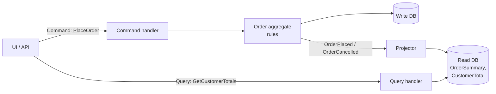

# 16 · CQRS (Command Query Responsibility Segregation)

**Definition:** use **separate models** for writing and reading. Commands change state through aggregates (write model); queries read from a denormalized **read model** shaped for the screen, updated by a projector from events.

## 1. Example

```
Initial data:
  write store / read store : empty

Commands:
  PlaceOrder ORD-1 Sara    : KB 2 x 100 + MOUSE 1 x 25 = 225 (3 items)
  PlaceOrder ORD-2 Omar    : MONITOR 1 x 1500           = 1500
  PlaceOrder ORD-3 Sara    : CABLE 4 x 5                = 20
  CancelOrder ORD-2        : projector subtracts 1500 from Omar

Queries:
  GetOrderSummary(ORD-1)   : ORD-1 | Sara | 3 items | 225 USD | Placed
  GetCustomerTotals()      : Sara 2 orders 245 USD ; Omar 0 orders 0 USD

Result:
  write model              : 3 Order aggregates, 4 lines (normalized)
  read model               : 3 summaries + 2 customer totals (ready to display, no joins)
```

## 2. Diagram



## 3. Code

```csharp
// Write side: command -> aggregate -> event
public void Handle(PlaceOrder cmd)
{
    var order = Order.Place(cmd.OrderId, cmd.CustomerName, cmd.Lines);
    writeStore[order.Id] = order;
    projector.On(new OrderPlaced(order.Id, order.CustomerName, itemCount, total));
}

// Read side: event -> ready-made row
public void On(OrderPlaced e)
{
    store.Summaries[e.OrderId] = new OrderSummary(e.OrderId, e.CustomerName, e.ItemCount, e.Total, "Placed");
    ...
}

// Query: no rules, no aggregates, just read
public IEnumerable<CustomerTotal> GetCustomerTotals() =>
    store.CustomerTotals.Values.OrderByDescending(c => c.TotalSpent);
```

Run: `dotnet run --project 16-cqrs`

```
Query: GetOrderSummary(ORD-1)
  ORD-1 | Sara | 3 items | 225 USD | Placed

Query: GetCustomerTotals() (only non-cancelled orders)
  Sara  | 2 orders | 245 USD
  Omar  | 0 orders | 0 USD

Write model rows: 3 Order aggregates with 4 lines
Read model rows : 3 summaries + 2 customer totals
```

## ✅ vs ❌

| ✅ Correct | ❌ Wrong | Why |
|---|---|---|
| commands return nothing (or an id) | `PlaceOrder` returns the full dashboard | mixes write and read concerns |
| queries never change state | `GetOrder` also marks it "seen" | surprises, caching breaks |
| read model per screen | load aggregates + joins for every list page | slow, aggregates bloated with display fields |
| accept **eventual consistency** on the read side (ms–s delay) | expect read model updated in the same instant | separate stores are async by nature |
| start with one DB, two models; split DBs only when needed | two databases + broker on day one for a CRUD app | complexity without need |

**Next →** [17 Event Sourcing](../17-event-sourcing/)
