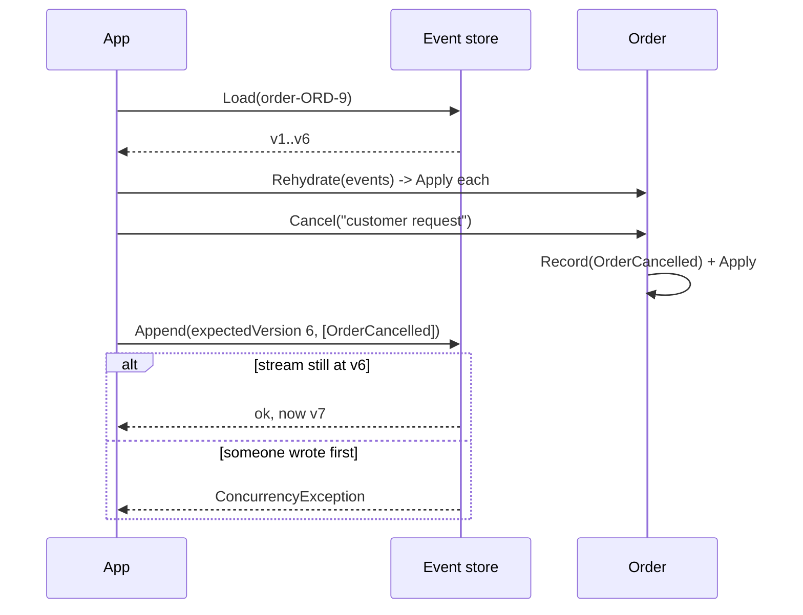

# 17 · Event Sourcing

**Definition:** store an aggregate as the **append-only list of its events** instead of its current state. Current state = replay of all events. Writes use an **expected version** to detect concurrent changes (optimistic concurrency).

## 1. Example

```
Initial data:
  stream order-ORD-9   : empty

Commands:
  v1 OrderCreated      : ORD-9, sara
  v2 LineAdded         : KB 2 x 100
  v3 LineAdded         : MOUSE 1 x 25
  v4 LineRemoved       : MOUSE
  v5 LineAdded         : MONITOR 1 x 1500
  v6 OrderPlaced

Replay:
  all 6 events         : Placed, 2 lines, total 2 x 100 + 1500 = 1700
  first 3 events (v3)  : Draft,  2 lines, total 200 + 25 = 225   (time travel)

Concurrency:
  user A, B load v6    : both Cancel()
  A appends at v6      : ok -> stream v7
  B appends at v6      : rejected (stream is at v7, you loaded v6)

Result:
  full history kept; MOUSE removal still visible at v4
```

## 2. Diagram



## 3. Code

```csharp
// Decide: check rules, then record an event
public void Cancel(string reason)
{
    if (Status != OrderStatus.Placed)
        throw new InvalidOperationException("only placed orders can be cancelled");
    Record(new OrderCancelled(reason));
}

// Evolve: the ONLY place state changes
private void Apply(IEvent e)
{
    switch (e)
    {
        case OrderCreated c: Id = c.OrderId; Status = OrderStatus.Draft; break;
        case LineAdded a: _lines[a.Sku] = (a.UnitPrice, a.Quantity); break;
        case LineRemoved r: _lines.Remove(r.Sku); break;
        case OrderPlaced: Status = OrderStatus.Placed; break;
        case OrderCancelled: Status = OrderStatus.Cancelled; break;
    }
    Version++;
}

// Store: reject stale writers
if (events.Count != expectedVersion)
    throw new ConcurrencyException($"stream is at v{events.Count}, you loaded v{expectedVersion}");
```

Run: `dotnet run --project 17-event-sourcing`

```
Event stream 'order-ORD-9'
  v1: OrderCreated { OrderId = ORD-9, CustomerId = sara }
  v2: LineAdded { Sku = KB, UnitPrice = 100, Quantity = 2 }
  v3: LineAdded { Sku = MOUSE, UnitPrice = 25, Quantity = 1 }
  v4: LineRemoved { Sku = MOUSE }
  v5: LineAdded { Sku = MONITOR, UnitPrice = 1500, Quantity = 1 }
  v6: OrderPlaced { }

Replay all events  -> current state
  status=Placed, lines=2, total=1700, version=6
Replay first 3     -> state at v3
  status=Draft, lines=2, total=225, version=3

  user A appends at expected v6: ok, stream now v7
  user B appends at expected v6: rejected -> stream is at v7, you loaded v6
```

## ✅ vs ❌

| ✅ Correct | ❌ Wrong | Why |
|---|---|---|
| events are immutable facts; fix with a new event (`LineRemoved`) | edit/delete an old event | history and audit become lies |
| state changes only in `Apply` | change fields directly in `Cancel()` | replay produces a different state |
| append with expected version | last write wins | lost updates between two users |
| snapshots every N events for long streams | replay 1M events per request | slow loads |
| use it where history matters (Core: money, orders, audit) | event sourcing every CRUD table | heavy cost, little value |
| tools: EventStoreDB, Marten (PostgreSQL) | home-made store in production | concurrency + projections are hard to get right |

**Next →** [18 Saga](../18-saga/)
