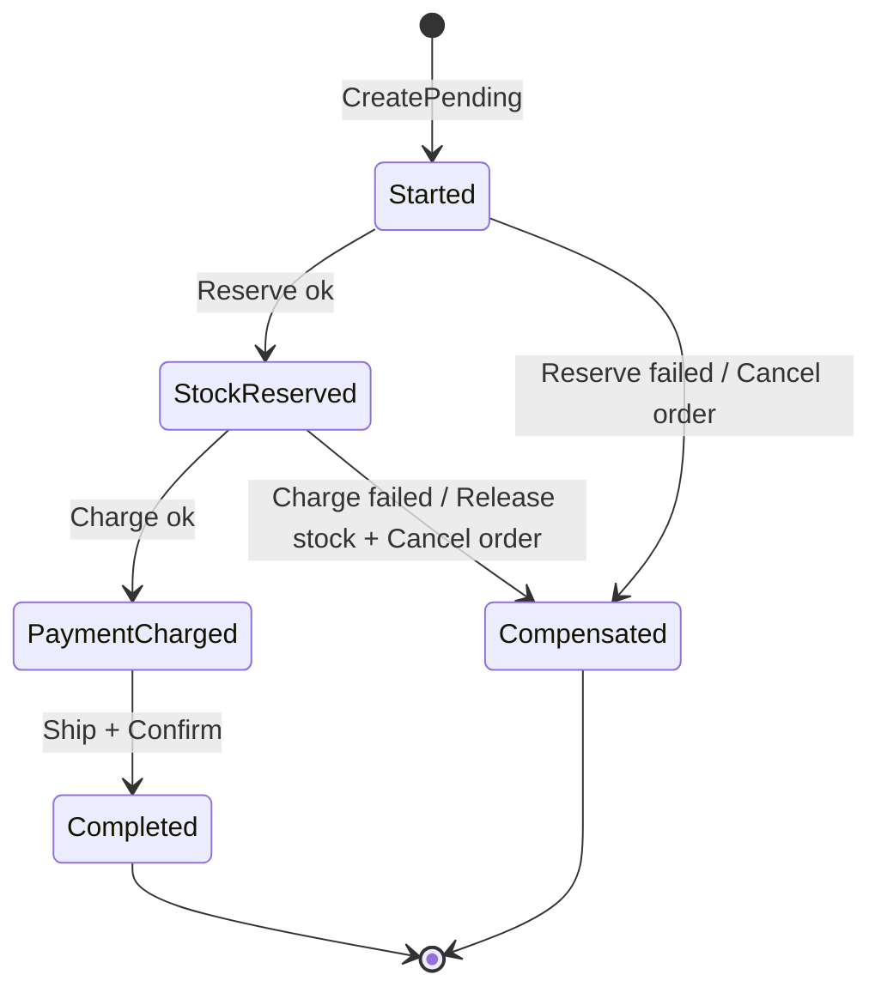
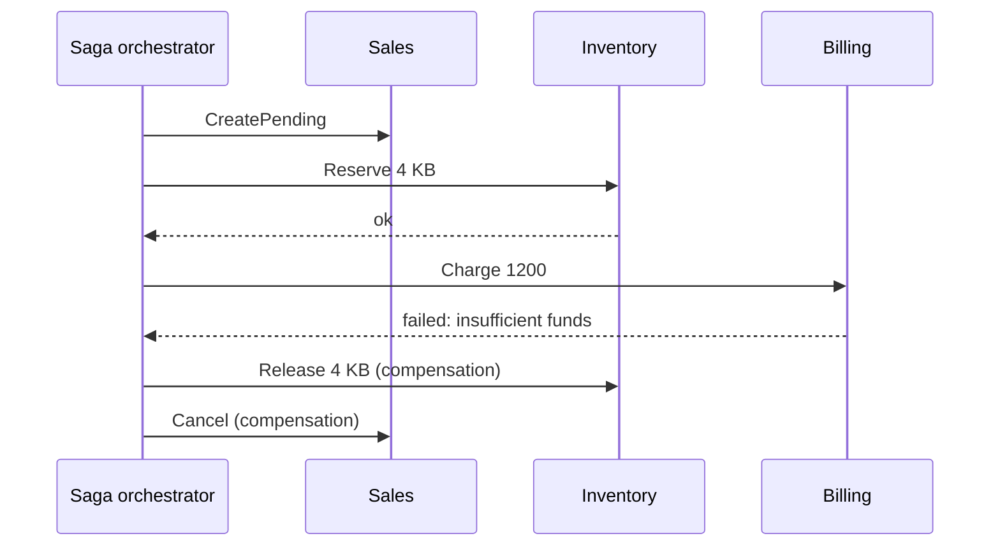

# 18 · Saga

**Definition:** a long-running business process across several bounded contexts, done as a **series of local transactions**. If a step fails, earlier steps are undone by **compensating actions** (not a rollback). Two styles: **orchestration** (one coordinator, used here) and **choreography** (contexts react to each other's events, see [19](../19-capstone-shop/)).

## 1. Example

Steps: create order (Pending) → reserve stock → charge payment → create shipment → confirm.

```
Scenario 1 (stock 5, balance 1000, order 3 x 100 = 300):
  reserve 3            : stock 2
  charge 300           : balance 700
  shipment             : SHP-ORD-1
  Result               : Completed, order Confirmed

Scenario 2 (stock 5, balance 1000, order 4 x 300 = 1200):
  reserve 4            : stock 1
  charge 1200          : FAILED (1200 > 1000)
  compensate           : release 4 -> stock 5 ; cancel order
  Result               : Compensated, order Cancelled, balance 1000

Scenario 3 (stock 2, balance 1000, order 3 x 100):
  reserve 3            : FAILED (only 2 in stock)
  compensate           : cancel order (nothing to release)
  Result               : Compensated, order Cancelled
```

## 2. Diagram





## 3. Code

```csharp
public SagaState Execute(OrderRequest r)
{
    orders.CreatePending(r.OrderId);
    try
    {
        inventory.Reserve(r.Sku, r.Quantity);  State = SagaState.StockReserved;
        payments.Charge(r.Total);              State = SagaState.PaymentCharged;
        shipping.CreateShipment(r.OrderId);
        orders.Confirm(r.OrderId);             State = SagaState.Completed;
    }
    catch (StepFailedException ex) { Compensate(r, ex.Message); }
    return State;
}

private void Compensate(OrderRequest r, string reason)   // undo in reverse order
{
    if (State >= SagaState.StockReserved) inventory.Release(r.Sku, r.Quantity);
    orders.Cancel(r.OrderId, reason);
    State = SagaState.Compensated;
}
```

Run: `dotnet run --project 18-saga`

```
Scenario 1: happy path  (stock=5, balance=1000, order=3 x 100 = 300)
  Sales     : order ORD-1 Pending
  Inventory : reserved 3 KB, left 2
  Billing   : charged 300, balance 700
  Shipping  : shipment SHP-ORD-1 created
  Sales     : order ORD-1 Confirmed
  => saga=Completed, order=Confirmed, stock left=2, balance=700, shipments=1

Scenario 2: payment fails  (stock=5, balance=1000, order=4 x 300 = 1200)
  Sales     : order ORD-1 Pending
  Inventory : reserved 4 KB, left 1
  !! step failed: insufficient funds: 1200 > 1000
  Inventory : released 4 KB, left 5  [compensation]
  Sales     : order ORD-1 Cancelled (insufficient funds: 1200 > 1000)  [compensation]
  => saga=Compensated, order=Cancelled, stock left=5, balance=1000, shipments=0

Scenario 3: out of stock  (stock=2, balance=1000, order=3 x 100 = 300)
  Sales     : order ORD-1 Pending
  !! step failed: only 2 KB in stock
  Sales     : order ORD-1 Cancelled (only 2 KB in stock)  [compensation]
  => saga=Compensated, order=Cancelled, stock left=2, balance=1000, shipments=0

```

## ✅ vs ❌

| ✅ Correct | ❌ Wrong | Why |
|---|---|---|
| local transaction per step + compensations | distributed transaction (2PC) across services | locks across services, poor availability |
| compensation = business action ("Release stock", "Refund") | "delete the row" | others may already have seen the state |
| persist saga state (crash in the middle must resume) | keep saga state only in memory | a restart leaves stock reserved forever |
| idempotent steps (retry-safe) | `Charge()` that charges twice on retry | customers pay twice |
| orchestration for many steps / clear owner; choreography for 2–3 steps | choreography for 10 steps | nobody can see the whole flow |
| tools: MassTransit state machines, Temporal, NServiceBus sagas | hand-rolled orchestrator in production | timeouts and retries are hard |

**Next →** [19 Capstone Shop](../19-capstone-shop/)
