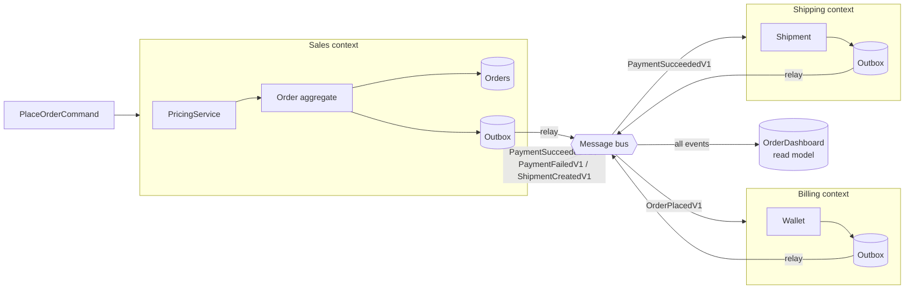
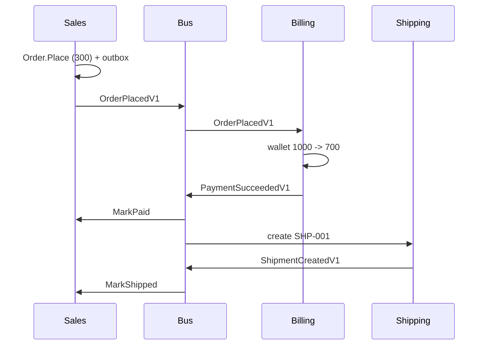
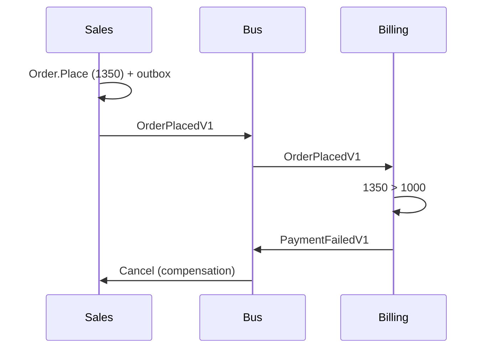
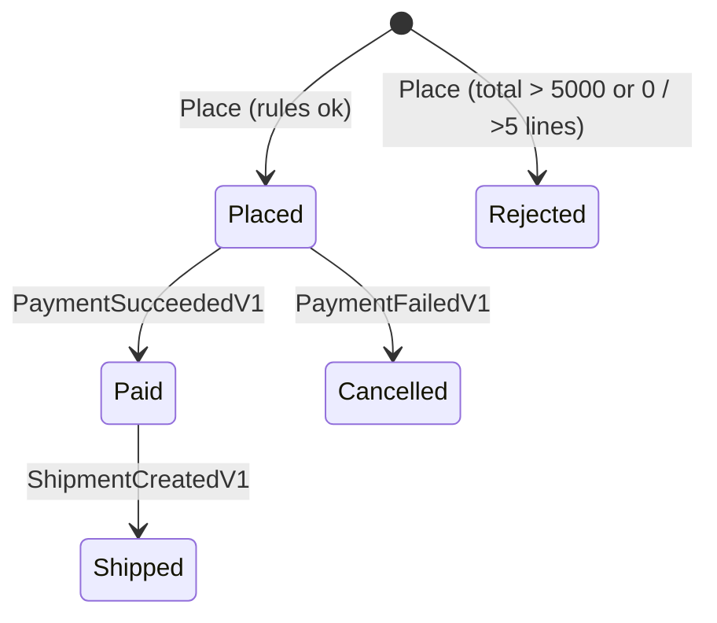

# 19 · Capstone: Online Shop

**Definition:** every concept from 00–18 combined in one small system with three bounded contexts (Sales, Billing, Shipping) plus a read model. The contexts talk only through integration events (choreography saga).

## Concept → where it lives

| # | Concept | File |
|---|---|---|
| 02 | Value object | [SharedKernel/Money.cs](SharedKernel/Money.cs) |
| 03, 04 | Entity, Aggregate root | [Sales/Order.cs](Sales/Order.cs) (`Order`, invariants: 1..5 lines, total ≤ 5,000) |
| 05 | Repository | [Sales/SalesModule.cs](Sales/SalesModule.cs) (`IOrderRepository`) |
| 06 | Domain service | [Sales/Pricing.cs](Sales/Pricing.cs) (`PricingService`: VIP 10% off) |
| 08 | Domain events | `OrderPlaced`, `OrderPaid`, `OrderShipped`, `OrderCancelled` |
| 10, 11 | Bounded contexts + Shared Kernel | `Sales/`, `Billing/`, `Shipping/`, `SharedKernel/` |
| 14 | Integration events | [Contracts/IntegrationEvents.cs](Contracts/IntegrationEvents.cs) |
| 15 | Outbox + Inbox (idempotency) | [Infrastructure/Outbox.cs](Infrastructure/Outbox.cs) |
| 16 | CQRS read model | [ReadModel/OrderDashboard.cs](ReadModel/OrderDashboard.cs) |
| 18 | Saga (choreography) | Billing reacts to `OrderPlacedV1`, Sales reacts to `PaymentFailedV1` → Cancel |

## 1. Example

```
Initial data:
  catalog              : KB 100, MOUSE 25, MONITOR 1500
  wallets              : sara 1000, omar 1000

Commands:
  1. sara (Regular)    : 2 KB + 4 MOUSE = 200 + 100 = 300
                         Billing charges 300 -> sara 700 -> Shipping SHP-001 -> order Shipped
  2. omar (VIP)        : 1 MONITOR = 1500 - 10% = 1350
                         Billing: 1350 > 1000 -> PaymentFailedV1 -> Sales cancels (compensation)
  3. sara              : 4 MONITOR = 6000 > 5000 -> rejected by Order aggregate, no event

Result (dashboard):
  ORD-1                : sara, 300,  Shipped, SHP-001
  ORD-2                : omar, 1350, Cancelled
  wallets              : sara 700, omar 1000 ; shipments 1
```

## 2. Diagrams

### Architecture



### Happy path (ORD-1)



### Payment failure (ORD-2)



### Order states



## 3. Code

```csharp
// Sales application service: no business rules, only orchestration
public void PlaceOrder(PlaceOrderCommand cmd)
{
    var (lines, discount) = _pricing.Price(cmd.Cart, cmd.Tier);           // domain service
    var order = Order.Place(new OrderId(cmd.OrderId), cmd.CustomerId, lines, discount);  // aggregate
    SaveWithEvents(order);                                                 // repo + outbox, one tx
}

// Billing reacts (choreography), idempotent through its inbox
private void OnOrderPlaced(Guid messageId, OrderPlacedV1 e)
{
    if (!_inbox.TryAccept(messageId)) return;
    var wallet = _wallets[e.CustomerId];
    if (wallet.TryCharge(e.Total)) Outbox.Add(new PaymentSucceededV1(e.OrderId, e.Total));
    else Outbox.Add(new PaymentFailedV1(e.OrderId, $"insufficient funds ({e.Total} > {wallet.Balance})"));
}
```

Run: `dotnet run --project 19-capstone-shop`

```
1. Sara (Regular) orders 2 KB + 4 MOUSE
  [Sales]    OrderPlaced { OrderId = ORD-1, CustomerId = sara, Total = 300.00 USD }
    [bus] OrderPlacedV1 {"OrderId":"ORD-1","CustomerId":"sara","Total":300}
  [Billing]  charged 300 to sara, balance 700
    [bus] PaymentSucceededV1 {"OrderId":"ORD-1","Amount":300}
  [Sales]    OrderPaid { OrderId = ORD-1 }
  [Shipping] SHP-001 for ORD-1
    [bus] ShipmentCreatedV1 {"OrderId":"ORD-1","ShipmentId":"SHP-001"}
  [Sales]    OrderShipped { OrderId = ORD-1, ShipmentId = SHP-001 }

2. Omar (VIP) orders 1 MONITOR
  [Sales]    OrderPlaced { OrderId = ORD-2, CustomerId = omar, Total = 1350.00 USD }
    [bus] OrderPlacedV1 {"OrderId":"ORD-2","CustomerId":"omar","Total":1350.00}
  [Billing]  insufficient funds (1350.00 > 1000)
    [bus] PaymentFailedV1 {"OrderId":"ORD-2","Reason":"insufficient funds (1350.00 > 1000)"}
  [Sales]    OrderCancelled { OrderId = ORD-2, Reason = insufficient funds (1350.00 > 1000) }

3. Sara orders 4 MONITOR (over the 5,000 USD limit)
  [Sales]    rejected -> total 6000.00 USD exceeds 5000.00 USD

Dashboard (read model)
  ORD-1 | sara |      300 | Shipped   | SHP-001
  ORD-2 | omar |  1350.00 | Cancelled | -
  wallets: sara=700, omar=1000; shipments=1
```

## Exercises (extend it yourself)

1. Add an **Inventory** context: reserve stock on `OrderPlacedV1`, release on `PaymentFailedV1`.
2. Replace the in-memory repository with **EF Core + SQLite**; keep the domain untouched.
3. Event-source the `Order` aggregate ([17](../17-event-sourcing/)).
4. Add a `IsVipCustomer` specification ([09](../09-specification/)) instead of passing `CustomerTier` in the command.
5. Replace `MessageBus` with **RabbitMQ via MassTransit**, with a real transactional outbox.
