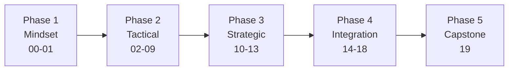
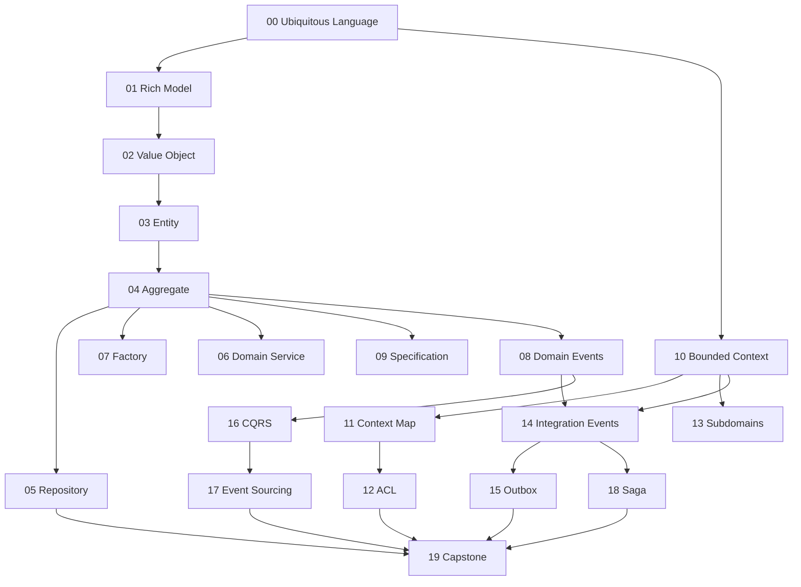

# Domain-Driven Design: Learn by Running Code

**Domain-Driven Design (DDD):** designing software around the **business domain**: a shared language with domain experts, a model that enforces business rules, and clear boundaries between parts of the business.

One running domain (an **Online Shop**) in every folder. Each folder = **one concept**, one small runnable C# console app, and one README (definition → example → diagram → code + real output → ✅/❌).

## Roadmap



| # | Folder | Concept | Shop example |
|---|---|---|---|
| **Phase 1: Mindset** ||||
| 00 | [ubiquitous-language](00-ubiquitous-language/) | Shared vocabulary in code and talk | `order.Place()` vs `Process(row, 1)` |
| 01 | [anemic-vs-rich-model](01-anemic-vs-rich-model/) | Behavior inside the object | empty order cannot be paid |
| **Phase 2: Tactical** ||||
| 02 | [value-object](02-value-object/) | Immutable, equal by value | `Money(10, USD) == Money(10, USD)` |
| 03 | [entity](03-entity/) | Equal by identity | two "Ali" customers, Id 1 ≠ Id 2 |
| 04 | [aggregate](04-aggregate/) | Consistency boundary + root | max 3 lines, total ≤ 5,000 |
| 05 | [repository](05-repository/) | Load/save whole aggregates | `GetAsync(id)` / `SaveAsync(order)` |
| 06 | [domain-service](06-domain-service/) | Logic spanning several objects | `PricingService.Quote` (VIP, coupon, shipping) |
| 07 | [factory](07-factory/) | Complex creation | `OrderFactory.FromCart` (price snapshot) |
| 08 | [domain-events](08-domain-events/) | Something that happened | `OrderPlaced` → email + loyalty |
| 09 | [specification](09-specification/) | Reusable, combinable rule | `IsVip AND NOT HasUnpaid AND LivesIn(SA)` |
| **Phase 3: Strategic** ||||
| 10 | [bounded-context](10-bounded-context/) | One model per boundary | "Product" in Sales vs Shipping |
| 11 | [context-map](11-context-map/) | How contexts relate | OHS, Published Language, Conformist, Shared Kernel |
| 12 | [anti-corruption-layer](12-anti-corruption-layer/) | Translate foreign models | legacy `cust_tp=V` → `CustomerTier.Vip` |
| 13 | [subdomains](13-subdomains/) | Core / Supporting / Generic | Pricing = Core, Login = Generic |
| **Phase 4: Integration** ||||
| 14 | [integration-events](14-integration-events/) | Public, versioned events | `OrderPlacedV1` → Shipping + Billing |
| 15 | [outbox-pattern](15-outbox-pattern/) | Atomic save + publish | broker down → retried, never lost |
| 16 | [cqrs](16-cqrs/) | Separate write and read models | `OrderSummary`, `CustomerTotal` |
| 17 | [event-sourcing](17-event-sourcing/) | State = replay of events | time travel to v3, optimistic concurrency |
| 18 | [saga](18-saga/) | Multi-step process + compensation | payment fails → release stock, cancel |
| **Phase 5** ||||
| 19 | [capstone-shop](19-capstone-shop/) | All together | Sales + Billing + Shipping + dashboard |

## How the concepts build on each other



## Run

Requires the [.NET 10 SDK](https://dotnet.microsoft.com/download).

```bash
dotnet build DomainDrivenDesign.slnx          # build all 20 apps
dotnet run --project 04-aggregate             # run one concept
for d in [01]*/; do echo "== $d"; dotnet run --project "$d"; done   # run all
```

## Study method (per folder)

1. Read the **Example** in the README and predict the output.
2. Run it and compare.
3. Break a rule on purpose (e.g. make a setter public) and see what goes wrong.
4. Re-read the ✅/❌ table.

## Further reading

| Resource | Why |
|---|---|
| Eric Evans, *Domain-Driven Design* (2003) | the original "blue book" |
| Vaughn Vernon, *Implementing Domain-Driven Design* (2013) | the "red book": aggregates, events, contexts in code |
| Vlad Khononov, *Learning Domain-Driven Design* (2021) | the most approachable modern intro, subdomains, Core Domain Chart |
| [ddd-crew on GitHub](https://github.com/ddd-crew) | Context Mapping, Bounded Context Canvas, Core Domain Chart |
| [Microsoft eShop reference app](https://github.com/dotnet/eShop) | DDD + microservices in .NET |
